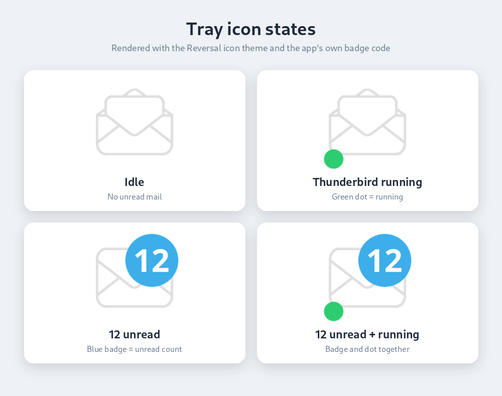
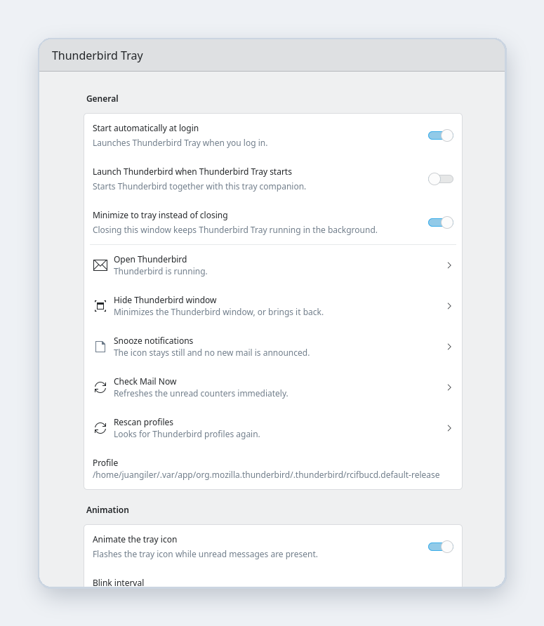

# Thunderbird Tray

A system tray companion for Mozilla Thunderbird on Linux.

It shows how many unread messages your monitored mail folders contain, animates
when new mail arrives, and puts Thunderbird, mail checks, window controls, and
settings one click away.

[](https://github.com/juangiler/thunderbird-tray/actions/workflows/ci.yml)
[](https://github.com/juangiler/thunderbird-tray/releases)
[](https://github.com/juangiler/thunderbird-tray/actions/workflows/release.yaml)


---

## Screenshots

<p align="center">
  
</p>
<p align="center"><sub>Flat monochrome application icon</sub></p>

<p align="center">
  
</p>
<p align="center"><sub>Preview rendered with the <a href="https://github.com/yeyushengfan258/Reversal-icon-theme">Reversal icon theme</a> by <a href="https://github.com/yeyushengfan258">yeyushengfan258</a> — thanks for the beautiful icons! This is just a preview: the tray glyph is not bundled, it follows your current system icon theme, so on your desktop it uses your own icons.</sub></p>

<p align="center">
  
</p>
<p align="center"><sub>Real settings window in the light theme — Kirigami 6 / Breeze on KDE Plasma</sub></p>

---

## Features

- Native `QSystemTrayIcon` with a painted unread badge (single tray icon)
- Tray icon follows your system icon theme (Reversal, Breeze, etc.) — the mail glyph is never bundled, so it always matches your desktop
- Green indicator dot shows when Thunderbird is running
- Smooth fade animation while unread mail is pending (configurable)
- Badge color follows the desktop accent color by default, or can be set manually
- Per-account badge colors: with one badge, the account with the most unread mail decides its color
- Counter color adapts to theme (white on dark, black on light) or can be customized
- Customizable counter font family and size
- Tray menu: **Open Thunderbird**, **Hide/Show Thunderbird Window** (KWin/Plasma), **Check Mail Now**, **Snooze Notifications**, **Settings…**, **Quit**
- Left-click the tray icon to open/focus Thunderbird
- Snooze new-mail notifications for a chosen duration (5/15/30/60 min, cancelable)
- Optional: launch Thunderbird automatically when Thunderbird Tray starts
- Optional: start Thunderbird Tray automatically at login
- Automatic detection of native, Flatpak, and Snap Thunderbird profiles/installations
- Unread counts read in the background (UI never blocks)
- Per-folder monitoring: choose exactly which folders are counted
- Kirigami 6 settings window (General / Animation / Appearance / Account colors / Monitored folders)
- Single instance, Wayland compatible (KDE Plasma primary target)

## Requirements

| | |
|---|---|
| Compiler | C++20 (GCC 13+, Clang 16+) |
| Build system | CMake ≥ 3.22 |
| Qt | 6.6+ (Core, Gui, Qml, Quick, QuickControls2, Widgets, Network, DBus) |
| KDE Frameworks | KF6 Kirigami, plus `kirigami-addons` (FormCard QML module, runtime) |
| Runtime | Modern Linux desktop; KDE Plasma 6 / Wayland (KWin) recommended |

On Fedora/KDE:

```bash
sudo dnf install cmake ninja-build gcc-c++ qt6-qtbase-devel qt6-qtdeclarative-devel \
                 qt6-qttools-devel kf6-kirigami-devel kf6-kirigami-addons
```

On Bazzite/Kinoite (immutable), install build dependencies in a toolbox/distrobox if they are not available on the host.

## Build

A Release build is recommended for regular use:

```bash
cd ~/Projects/thunderbird-tray
cmake -B build -S . -DCMAKE_BUILD_TYPE=Release
cmake --build build -j
```

The binary is `build/thunderbird-tray`. You can run it without installing:

```bash
./build/thunderbird-tray
# or open settings on start:
./build/thunderbird-tray --settings
```

For development/debugging you can use `-DCMAKE_BUILD_TYPE=Debug`.

### Tests

```bash
ctest --test-dir build --output-on-failure
```

| Test | What it covers |
|------|----------------|
| `tst_tbparser` | parsing of `prefs.js` and `folderCache.json` |
| `tst_foldermodel` | folder list, counters, and monitoring state |
| `tst_themecolors` | accent color and theme brightness detection |
| `tst_trayicon` | badge rendering, colors, running indicator, fade animation |
| `qmllint` | QML linting (unknown/shadowed properties) |

## Install on KDE

### Per-user install (recommended on Bazzite/KDE)

Installs into `~/.local` (no sudo, works well on immutable systems):

```bash
cd ~/Projects/thunderbird-tray
cmake -B build -S . -DCMAKE_BUILD_TYPE=Release -DCMAKE_INSTALL_PREFIX=$HOME/.local
cmake --build build -j
cmake --install build
```

This installs:
- `~/.local/bin/thunderbird-tray`
- `~/.local/share/applications/io.github.juangiler.thunderbird-tray.desktop`
- `~/.local/share/icons/hicolor/scalable/apps/io.github.juangiler.thunderbird-tray.svg`
- `~/.local/share/metainfo/io.github.juangiler.thunderbird-tray.metainfo.xml`

Notes:
- Ensure `~/.local/bin` is in your `PATH` (common on Fedora/KDE).
- Launch from KRunner/app launcher as **Thunderbird Tray**, or run `thunderbird-tray`.
- If it doesn’t appear immediately, try `update-desktop-database ~/.local/share/applications` and/or `kbuildsycoca6 --noincremental`, or log out/in once.

### System-wide install (alternative)

```bash
cmake -B build -S . -DCMAKE_BUILD_TYPE=Release
cmake --build build -j
sudo cmake --install build
```

## Usage

Thunderbird Tray lives in the system tray (the window is hidden by default). On Plasma it may appear in the tray overflow area the first time — you can pin it to keep it visible.

| Action | How |
|--------|-----|
| Open/focus Thunderbird | Left-click the tray icon, or **Open Thunderbird** in the menu |
| Hide / show Thunderbird window | **Hide/Show Thunderbird Window** in the tray menu or in Settings (requires KWin/Plasma) |
| Check mail now | **Check Mail Now** in the menu (refreshes local counters; starts Thunderbird if not running) |
| Snooze notifications | **Snooze Notifications** in the tray menu or in Settings |
| Settings | **Settings…** in the menu, or `thunderbird-tray --settings` |
| Quit | **Quit** in the menu |

### Settings highlights (General)

- **Start automatically at login**: launches Thunderbird Tray when you log in (autostart entry)
- **Launch Thunderbird when Thunderbird Tray starts**: starts Thunderbird together with the tray companion (optional, off by default)
- **Minimize to tray instead of closing**: keeps running in the background when the settings window is closed

Snooze suppresses the new-mail animation/hint for the selected duration (in-memory for the current run). Hide/restore window actions require KDE Plasma/KWin.

### Command line options

| Option | Effect |
|--------|--------|
| `-s`, `--settings` | Open the settings window on start |
| `--dump-state` | Print detected profile/state and exit (diagnostics) |
| `-h`, `--help` | Show usage |
| `-v`, `--version` | Show version |

## How it works

Thunderbird does not provide a public API for this state, so the app reads data Thunderbird already writes to disk:

| File | Used for |
|------|----------|
| `profiles.ini` (native / Flatpak / Snap locations) | finding the active profile |
| `<profile>/prefs.js` | account names, identities, server directories |
| `<profile>/folderCache.json` | per-folder unread and total message counts |

Parsing and scanning run on a worker thread; the GUI receives the finished result.

## Updating

Rebuild and reinstall with the same commands:

```bash
cmake --build build -j
cmake --install build
```

If Thunderbird Tray is running, quit it from the tray and start the updated binary.

## Uninstall

### Per-user install (`~/.local`)

```bash
rm -f ~/.local/bin/thunderbird-tray
rm -f ~/.local/share/applications/io.github.juangiler.thunderbird-tray.desktop
rm -f ~/.local/share/icons/hicolor/scalable/apps/io.github.juangiler.thunderbird-tray.svg
rm -f ~/.local/share/metainfo/io.github.juangiler.thunderbird-tray.metainfo.xml
rm -f ~/.config/autostart/io.github.juangiler.thunderbird-tray.desktop  # if autostart was enabled
```

Settings are stored in `~/.config/io.github.juangiler/thunderbird-tray.conf` (remove it if you want a full reset).

## Troubleshooting

**"No Thunderbird profile was found"**
Start Thunderbird once so that it writes `folderCache.json`, then use **Rescan profiles** in settings.

**The counter does not change**
Thunderbird updates its cache when it checks mail. The counter can’t be fresher than Thunderbird’s own cache — use **Check Mail Now** to rescan locally.

**The tray icon is missing**
On KDE Plasma the icon may be in the system tray overflow/hidden icons area; pin it to keep it visible.

**Hide/Show window is unavailable**
This feature requires KDE Plasma/KWin scripting support.

**Debugging**

```bash
./build/thunderbird-tray --dump-state
```

## Project layout

```
src/
  main.cpp              application entry point, single-instance guard
  backend.{h,cpp}       AppBackend — settings and QML-facing API
  tbwatcher.{h,cpp}     profile discovery and polling (worker thread)
  tbparser.{h,cpp}      pure parsing of prefs.js and folderCache.json
  foldermodel.{h,cpp}   list model of monitored folders
  trayicon.{h,cpp}      system tray icon, badge, animation, menu
  themecolors.{h,cpp}   accent color and theme brightness detection
  thunderbirdwindow.{h,cpp} hide/restore Thunderbird window via KWin scripting
  qml/
    Main.qml            (initially hidden) window
    SettingsCard.qml    settings UI
tests/                  parser, model, theme, tray icon, and QML lint tests
resources/              icon, .desktop file, AppStream metadata, screenshots/
```

`AGEND.md` contains the design document, stack review, feature comparison, and agenda.

## License

GPL-3.0-or-later
